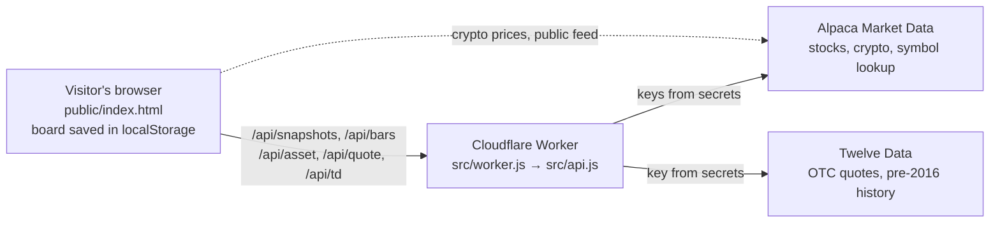

# STOCK Watch

[](CHANGELOG.md)
[](https://developers.cloudflare.com/workers/)

A live market board you build yourself. Add the stocks, ETFs and crypto you care about, group them into your own categories, arrange them by dragging, and set price alerts in both directions.

**Live site:** hosted on Cloudflare Workers (`stock-watch` Worker). The previous Netlify deployment at https://stockwatch-m7.netlify.app is kept as a fallback.

Every visitor starts with an empty board. Boards, categories and alerts are saved in each visitor's own browser, so you can share the link and everyone gets their own. Nobody needs an API key: the data keys live on the server.

---

## Features

- **Your own board.** Add any US stock or ETF, or any crypto Alpaca supports, by ticker. Each symbol is checked before it's added, and the company or coin name is filled in. Quick-add buttons and a sample watchlist help you get started. Remove a card with its **×**, and use **Undo** if you change your mind.
- **Custom categories.** Create, rename and delete categories (for example "Long term", "Earnings this week", "Crypto"). The board shows a section per category, with filter chips to focus on one.
- **Drag to arrange.** Drag cards to reorder them or move them between categories, on desktop or touch. Each card's detail view also has a category picker and **Move earlier / Move later** buttons.
- **Two-way price alerts.** For any symbol, set a *falls to* price below the current price, a *rises to* price above it, or both. When the price crosses a level you get an on-page alert, a browser notification and a short sound. Alert levels are drawn on the chart, and the **Alerts** panel lists every alert with its status. Triggered alerts turn off and can be turned back on.
- **Live prices, light on requests.** While the page is in view during market hours, stocks refresh every 5 seconds and crypto every 5 seconds. In a background tab both slow to every 30 seconds, and when the market is closed stocks refresh every 5 minutes. Crypto comes straight from Alpaca's public feed, so it costs the server nothing. OTC stocks refresh every 2 minutes during market hours.
- **Price history.** Open any card for an interactive chart with **1D, 5D, 1M, 6M, YTD, 5Y and Lifetime** ranges, a hover tooltip, and range stats.
- **Market strip.** Nasdaq-100, Dow Jones and S&P 500, tracked through QQQ, DIA and VOO.
- **Sorting and search.** Keep your own order, or sort by biggest losers, biggest gainers, price or symbol, and filter by name.
- **Light and dark themes**, following the visitor's system setting, and a layout that works on phones.

## How it works



- **`public/index.html`** is the whole app: HTML, CSS and JavaScript in one file, with no build step. The only external script is [SortableJS](https://github.com/SortableJS/Sortable) (from cdnjs) for drag and drop.
- **`src/api.js`** holds all the API logic. It uses only web-standard `fetch`, `Request` and `Response`, so the same file runs on Cloudflare and Netlify. It accepts only well-formed symbols on fixed routes and marks short-lived responses as cacheable at the edge.
- **`src/worker.js`** is the Cloudflare entry point. Cloudflare serves `public/` directly; the Worker runs only for `/api/*` and shares cached responses between visitors.
- **`netlify/functions/api.mts`** is a thin Netlify wrapper around the same `src/api.js`, kept so the app can still be hosted on Netlify.
- When the page finds the API (`/api/health`), it hides the key fields. Opened as a local file, it uses keys entered on the page or in its `CONFIG` block.

### What's stored in the browser

Everything a visitor sets up is kept in `localStorage` under `sw.board.v2`:

```js
{
  items:  [{ key: "AAPL", sym: "AAPL", kind: "stock", name: "Apple Inc.", otc: false, cat: "k3x9a1" },
           { key: "BTC/USD", sym: "BTC", kind: "crypto", name: "Bitcoin", otc: false, cat: null }],
  cats:   [{ id: "k3x9a1", name: "Big Tech" }],
  alerts: [{ id: "…", key: "AAPL", dir: "below", price: 180, created: 1763900000000, fired: null }]
}
```

Array order is display order. Stocks added with v1.1's "Add stock" (`sw.custom`) are migrated automatically on first load.

### Data sources

| Data | Source | Notes |
|---|---|---|
| Live stock prices | Alpaca (IEX feed) | Free plan; real-time trades from the IEX exchange |
| Stock history | Alpaca (consolidated feed) | Free plan allows data older than 15 minutes; back to 2016 |
| Crypto prices and history | Alpaca crypto | Any X/USD pair Alpaca lists |
| Symbol lookup | Alpaca assets API | Confirms a ticker and returns its name and exchange |
| OTC stock quotes | Twelve Data | Free plan: 8 requests/min, 800/day |
| Lifetime history before 2016 | Twelve Data | Same limits |

## Project structure

```
STOCK-WATCH/
├── public/
│   └── index.html            # the app (served as static files)
├── src/
│   ├── api.js                # API logic shared by both hosts
│   └── worker.js             # Cloudflare Worker entry point
├── netlify/
│   └── functions/
│       └── api.mts           # Netlify wrapper around src/api.js
├── wrangler.jsonc            # Cloudflare Workers config
├── netlify.toml              # Netlify config
├── package.json              # version and dev tooling
├── CHANGELOG.md              # release notes
└── README.md
```

## Setup

### 1. Get free API keys

- **Alpaca:** sign up at [alpaca.markets](https://app.alpaca.markets/signup) (no funding needed). In the **Paper** account, open **API Keys**, click **Generate**, and copy the Key ID and Secret. The Secret is shown only once.
- **Twelve Data** (optional, for OTC stocks and pre-2016 history): sign up at [twelvedata.com](https://twelvedata.com/register) and copy your API key.

### 2. Deploy on Cloudflare (recommended, free)

1. Sign up at [dash.cloudflare.com](https://dash.cloudflare.com).
2. Go to **Workers & Pages → Create → Import a repository**, connect GitHub and pick this repository. The Worker name must be `stock-watch` (or change `name` in `wrangler.jsonc` to match). Leave the build command empty; the deploy command is `npx wrangler deploy`.
3. Open the Worker's **Settings → Variables and Secrets**, choose **Add**, set the type to **Secret**, and add:

| Name | Value |
|---|---|
| `ALPACA_KEY_ID` | Alpaca Key ID (starts with `PK`) |
| `ALPACA_SECRET` | Alpaca Secret |
| `TWELVEDATA_KEY` | Twelve Data API key (optional) |

4. Every push to `main` deploys automatically. Check the setup at `https://<your-worker>.workers.dev/api/health`, which should return `{"alpaca":true,"td":true}`.

On the Workers Free plan, function requests are limited to 100,000 a day (static files are free and unlimited). With the refresh rates above, one tab open during market hours uses about 720 requests an hour.

### Alternative: deploy on Netlify

Add the same three values under **Project configuration → Environment variables** (tick **Contains secret values**), then deploy with Node.js installed:

```bash
npx netlify-cli login
npx netlify-cli deploy --prod --build --site <your-site-id>
```

Netlify reads environment variables at deploy time, so redeploy after changing a key. On Netlify's credit-based Free plan the site pauses for the rest of the month once its credits run out.

### Run locally

Open `public/index.html` in a browser, paste your keys into the fields at the top, and click **Connect**. Keys entered this way stay in that browser.

## Price alerts: how they behave

- An alert checks each live price update. A *falls to* alert fires when the price is at or below the level; a *rises to* alert fires at or above it.
- When creating an alert, the falls-to price must be below the current price and the rises-to price above it, so an alert can't fire the instant it's set.
- Alerts are one-shot: after firing they switch off. Use **Turn back on** in the alert list to re-arm one.
- Browser notifications are requested the first time you set an alert. If they're blocked, alerts still appear on the page.
- Alerts run while STOCK Watch is open in a browser tab (it can be in the background). They don't reach you when the page is closed.

## Versioning and contributing

- Releases follow [Semantic Versioning](https://semver.org) and are tagged `vMAJOR.MINOR.PATCH`. See [CHANGELOG.md](CHANGELOG.md) for what changed in each release.
- Work happens on short-lived branches (`feature/…`, `fix/…`) merged into `main`; `main` is always what's deployed.
- Commit messages follow [Conventional Commits](https://www.conventionalcommits.org) (`feat:`, `fix:`, `docs:`, `chore:`).
- When releasing, update the version in `package.json` and `VERSION` in `public/index.html`, add a CHANGELOG entry, and tag the merge commit.

## Security

- API keys are stored only as Cloudflare secrets (or Netlify environment variables) and used by the server code. They never reach the browser and are not in this repository.
- The proxy accepts only well-formed symbols (at most 80 stocks or 40 crypto pairs per request) on fixed routes, so it can't be used as a general relay. Short-lived responses are cached at the edge and shared between visitors to stay within the free tiers.
- Visitors' boards and alerts never leave their browser.
- If a key is ever exposed, regenerate it at the provider and update the secret on your host (on Netlify, redeploy afterwards).

## Known limitations

- Alerts need the page to be open. Alerts that reach your phone with the page closed would need accounts and a server-side scheduler.
- Boards are per browser and don't sync between devices.
- Free live stock data comes from one exchange (IEX), so prices can differ by a few cents from the full market price.
- Alpaca history begins in 2016 (2021 for crypto); Twelve Data fills in older Lifetime data.
- Prices outside regular trading hours reflect the last trade.

## Disclaimer

For information and education only. This is not investment advice.
