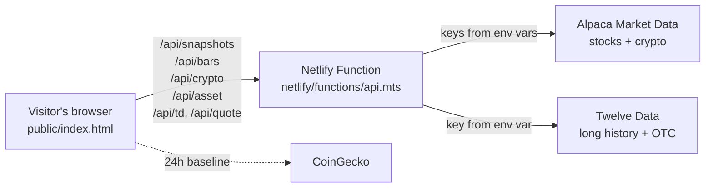

# STOCK Watch

A live market dashboard for a personal watchlist: 37 tech, AI, semiconductor, storage, quantum and space stocks, plus Bitcoin, Ethereum, Solana, XRP, and the Nasdaq-100, Dow Jones and S&P 500.

**Live demo:** https://stockwatch-m7.netlify.app

Anyone with the link sees live prices and full price history without needing their own API keys. The keys live on the server, never in the browser.

---

## Features

- **Live prices.** Stocks refresh every 3 seconds during market hours, crypto around the clock.
- **Benchmarks.** Nasdaq-100, Dow Jones and S&P 500 (tracked through QQQ, DIA and VOO), plus BTC and ETH.
- **Market breadth.** A bar showing how many names are up, down or flat.
- **Add your own stocks.** Type any US stock or ETF ticker into **Add stock**. The site checks that it exists, fills in the company name, and adds a live card under **My stocks**. Each viewer's additions are saved in their own browser (up to 25), so friends can build their own boards without changing yours. Remove a card with its **×**.
- **Grouping and sorting.** Filter by theme (Semis, AI & Cloud, Storage, Quantum, Big Tech, Space, Crypto, Funds & Metals), search by symbol or name, and sort by biggest losers, gainers, price or A–Z.
- **Price history.** Click any card for an interactive chart with **1D, 5D, 1M, 6M, YTD, 5Y and Lifetime** ranges, a hover tooltip, and range stats (start, high, low, last, distance from high).
- **Tick flashes.** Cards flash green or red when the price moves.
- **Market status.** Shows open, pre-market, after-hours or closed, with an Eastern Time clock.
- **Light and dark themes.** Follows the viewer's system setting.

## How it works



- **`public/index.html`** is the whole dashboard: HTML, CSS and JavaScript in one file, with no framework or build step.
- **`netlify/functions/api.mts`** is a small serverless proxy. It reads the API keys from Netlify environment variables, only answers for the dashboard's own symbols, and sets CDN cache headers so many viewers share one upstream request. This keeps usage inside free-tier limits.
- When the page finds the proxy (`/api/health`), it hides the key fields and runs in **demo mode**. Opened as a local file, it falls back to keys entered in the page or in its `CONFIG` block.

### Data sources

| Data | Source | Notes |
|---|---|---|
| Live stock prices | Alpaca (IEX feed) | Free plan; real-time trades from the IEX exchange |
| Stock history | Alpaca (consolidated feed) | Free plan allows data older than 15 minutes; goes back to 2016 |
| Crypto prices and history | Alpaca crypto | Public data |
| Crypto 24h change | CoinGecko | Public data, best effort |
| Lifetime history before 2016 | Twelve Data | Free plan: 8 requests/min, 800/day |
| OTC stocks (HGRAF, or any you add) | Twelve Data quote | Every 2 min in market hours, every 30 min otherwise |
| Ticker lookup for **Add stock** | Alpaca assets API | Confirms the symbol and returns the company name |

## Project structure

```
STOCK-WATCH/
├── public/
│   └── index.html            # the dashboard
├── netlify/
│   └── functions/
│       └── api.mts           # key-hiding API proxy
├── netlify.toml              # publish folder + functions folder
├── package.json
└── README.md
```

## Setup

### 1. Get free API keys

- **Alpaca:** sign up at [alpaca.markets](https://app.alpaca.markets/signup) (no funding needed). In the **Paper** account, open **API Keys**, click **Generate**, and copy the Key ID and Secret. The Secret is shown only once.
- **Twelve Data:** sign up at [twelvedata.com](https://twelvedata.com/register) and copy your API key.

### 2. Add the keys to Netlify

In your Netlify project, go to **Project configuration → Environment variables → Add a variable**, and create these three with **Contains secret values** ticked:

| Key | Value |
|---|---|
| `ALPACA_KEY_ID` | Alpaca Key ID (starts with `PK`) |
| `ALPACA_SECRET` | Alpaca Secret |
| `TWELVEDATA_KEY` | Twelve Data API key |

### 3. Deploy

You need [Node.js](https://nodejs.org) (LTS) installed.

```bash
npx netlify-cli login
npx netlify-cli deploy --prod --build --site <your-site-id>
```

Netlify reads environment variables at deploy time, so redeploy after changing any key.

Check the setup at `https://<your-site>.netlify.app/api/health`. It should return:

```json
{"alpaca":true,"td":true}
```

### Run locally without Netlify

Open `public/index.html` in a browser, then paste your keys into the fields at the top and click **Connect**. Keys entered this way are stored only in that browser.

## Customizing the watchlist

- **Per viewer:** use **Add stock** on the page. Added symbols are stored in that browser's local storage under `sw.custom`.
- **Default board for everyone:** edit the `SNAP` array near the top of the script in `public/index.html` (symbol, name, fallback price, fallback % change, group), and add the symbol to the `STOCKS` set in `netlify/functions/api.mts`.

## Security

- API keys are stored only as Netlify environment variables and are used by the server function. They never reach the browser and are not in this repository.
- The proxy only accepts well-formed ticker symbols (at most 80 per request) and fixed endpoints, so it can't be used as a general relay to the data APIs. Responses are cached at Netlify's edge to keep usage within the free tiers.
- If a key is ever exposed, regenerate it at the provider, update it in Netlify, and redeploy.

## Known limitations

- Free live data comes from one exchange (IEX), so prices can differ by a few cents from the full market price.
- Alpaca history begins in 2016 (2021 for crypto). Twelve Data fills in older Lifetime data.
- Nasdaq and the Dow are shown through ETFs, not the index values themselves.
- Prices outside regular trading hours reflect the last trade.

## Disclaimer

For information and education only. This is not investment advice.
